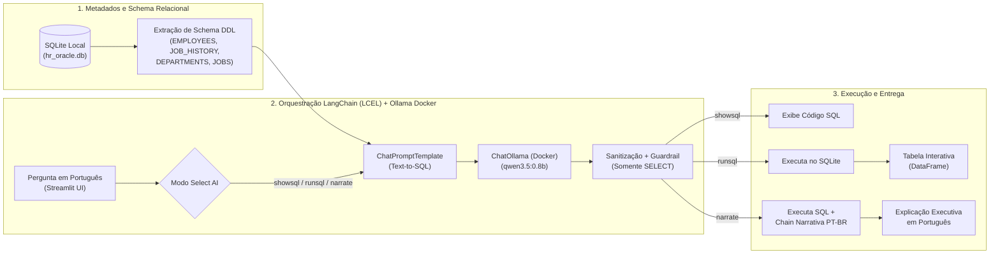

# Select AI Local — Agente Text-to-SQL com LangChain, Ollama (Docker) e Streamlit


Uma implementação **100% local, gratuita e open-source** inspirada no recurso **Select AI** do **Oracle AI Database 26ai**. Este projeto permite consultar bancos de dados relacionais (utilizando o clássico schema **HR** da Oracle) por meio de **linguagem natural em Português do Brasil (Text-to-SQL / NL2SQL)**, orquestrado com **LangChain (LCEL)**, **Ollama em Docker** e interface interativa em **Streamlit**.

---

## Visão Geral e Problema de Negócio

Consultar dados estruturados em bancos relacionais normalmente exige domínio de SQL (`JOINs`, `GROUP BY`, `HAVING`, subqueries). Recursos modernos como o *Oracle 26ai Select AI* democratizam esse acesso traduzindo perguntas em linguagem natural para SQL, mas exigem **assinaturas de APIs pagas na nuvem** (OpenAI, OCI Generative AI, Cohere) e envio de metadados corporativos para fora do ambiente local.

Este projeto demonstra como construir a **mesma experiência do Select AI rodando 100% localmente**:
- **Zero Custo de API & Privacidade Total:** O motor de IA roda localmente em container Docker via **Ollama** (`qwen3.5:0.8b`).
- **4 Modos Nativos do Select AI (`runsql`, `showsql`, `narrate` e `chat`):** Reproduz fielmente os operadores do Select AI em uma interface visual moderna.
- **Guardrails de Segurança (Read-Only SQL):** Validação por expressão regular que bloqueia qualquer instrução de modificação (`DROP`, `DELETE`, `UPDATE`, `INSERT`, `ALTER`), garantindo execução segura apenas de consultas `SELECT`.

---

## Arquitetura do Sistema (Pipeline Text-to-SQL com LCEL)



---

## Comparativo: Modos do Select AI Implementados

| Modo Select AI | Comando Equivalente no Oracle 26ai | O que a Aplicação Faz |
| :--- | :--- | :--- |
| **`runsql`** | `SELECT AI runsql <pergunta>;` | Converte a pergunta em SQL, valida no *guardrail* de segurança, executa no banco `HR` e exibe a tabela interativa + query utilizada. |
| **`showsql`** | `SELECT AI showsql <pergunta>;` | Gera e exibe apenas a instrução SQL correspondente à pergunta em linguagem natural, sem executar no banco. |
| **`narrate`** | `SELECT AI narrate <pergunta>;` | Gera o SQL, executa a consulta no banco e aciona uma segunda *chain* LCEL para narrar os resultados em Português do Brasil. |
| **`chat`** | `SELECT AI chat <pergunta>;` | Conversa livre com o LLM local sobre conceitos de banco de dados, modelagem relacional, SQL e RH. |

---

## Tecnologias Utilizadas

| Camada | Tecnologia | Papel no Projeto |
| :--- | :--- | :--- |
| **Front-end / Data App** | [Streamlit](https://streamlit.io/) | Interface de chat, seletor de modos (`st.segmented_control`), métricas e explorador de tabelas. |
| **Orquestração LLM** | [LangChain (LCEL)](https://www.langchain.com/) | Pipelines declarativos (`prompt \| llm \| StrOutputParser()`) para Text-to-SQL e Data-to-Text. |
| **Motor de IA (Docker)** | [Ollama](https://ollama.com/) (`qwen3.5:0.8b`) | Inferência local de baixa latência containerizada via Docker Compose. |
| **Banco Relacional** | [SQLite](https://www.sqlite.org/) + [Pandas](https://pandas.pydata.org/) | Banco de dados embarcado pré-populado com o schema clássico `HR` da Oracle. |

---

## Estrutura do Repositório

```text
AgenteSelectAILocal/
├── app.py                 # Interface Streamlit e pipelines LangChain (LCEL) para os 4 modos do Select AI
├── database.py            # Criação automática do banco SQLite (Schema HR), extração DDL e guardrails SQL
├── docker-compose.yml     # Serviço Docker para execução isolada do Ollama com volume persistente
├── requirements.txt       # Dependências Python do projeto
└── README.md              # Documentação técnica e guia de execução
```

---

## Como Executar o Projeto Localmente

### 1. Subir o Ollama no Docker e Baixar o Modelo

```bash
# Subir o container do Ollama na porta 11434
docker compose up -d

# Baixar o modelo leve utilizado pelo agente
docker exec -it ollama-select-ai ollama pull qwen3.5:0.8b
```

*(Nota: Caso você já tenha outro container do Ollama ou o Ollama local rodando na porta `11434` com o modelo `qwen3.5:0.8b`, a aplicação conectará nele automaticamente).*

### 2. Instalar as Dependências Python

```bash
# Criar e ativar ambiente virtual (Windows PowerShell)
python -m venv .venv
.\.venv\Scripts\Activate.ps1

# Instalar bibliotecas
pip install -r requirements.txt
```

### 3. Executar a Aplicação no Streamlit

```bash
streamlit run app.py
```

Acesse no navegador em: **`http://localhost:8501`**

---

## Exemplos de Consultas em Português para Testar

1. **"Mostre quais funcionários mudaram de cargo pelo menos duas vezes"**
   - *Reproduz o exemplo clássico do artigo do Oracle 26ai Select AI, realizando `JOIN` entre `EMPLOYEES` e `JOB_HISTORY` com `GROUP BY` e `HAVING COUNT(DISTINCT JOB_ID) >= 2` (retornando Neena Yang, Jennifer Whalen e Jonathon Taylor).*
2. **"Liste todos os funcionários e seus salários"**
   - *Cruza `EMPLOYEES` e `DEPARTMENTS` ordenando pelos maiores salários.*
3. **"Qual a média salarial por departamento?"**
   - *Gera agregação com `AVG(SALARY)` e `COUNT(EMPLOYEE_ID)` agrupada por departamento.*
4. **"Quem são os funcionários do departamento de TI (IT)?"**
   - *Filtra colaboradores pelo nome do departamento na tabela `DEPARTMENTS`.*
